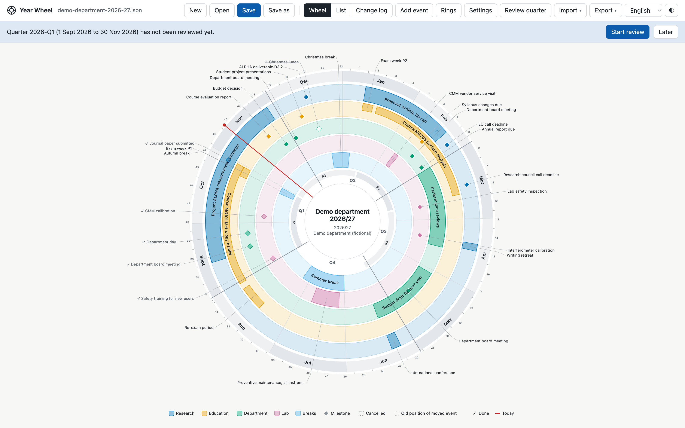
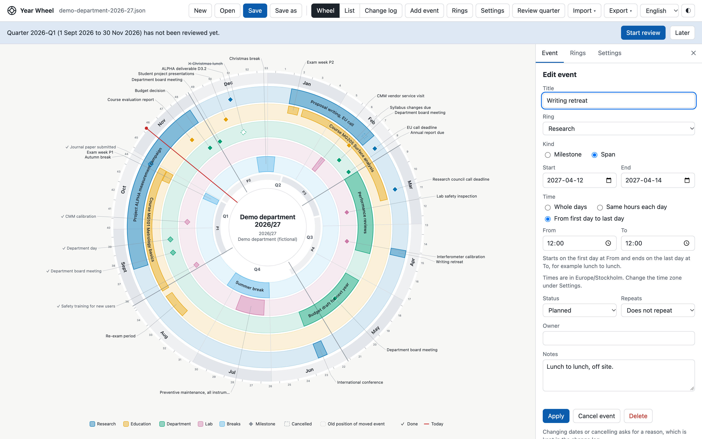
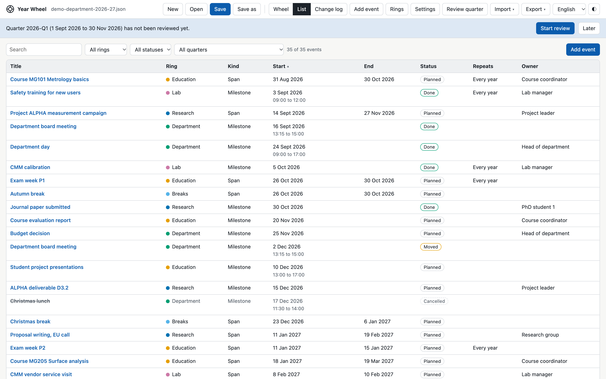
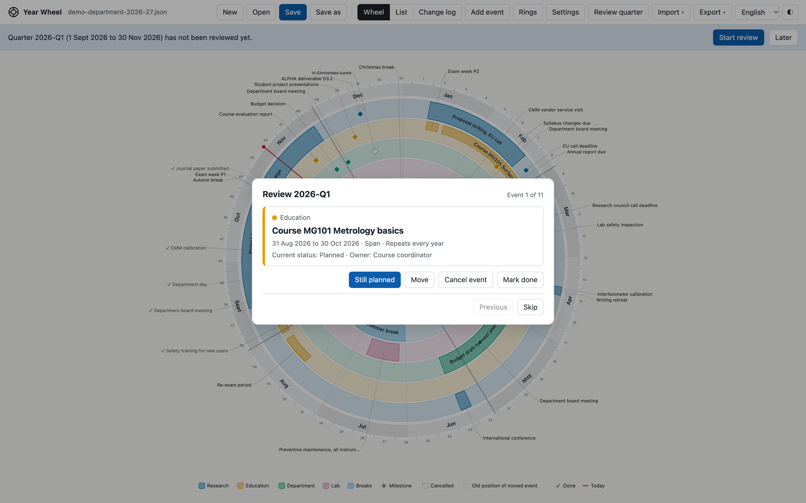
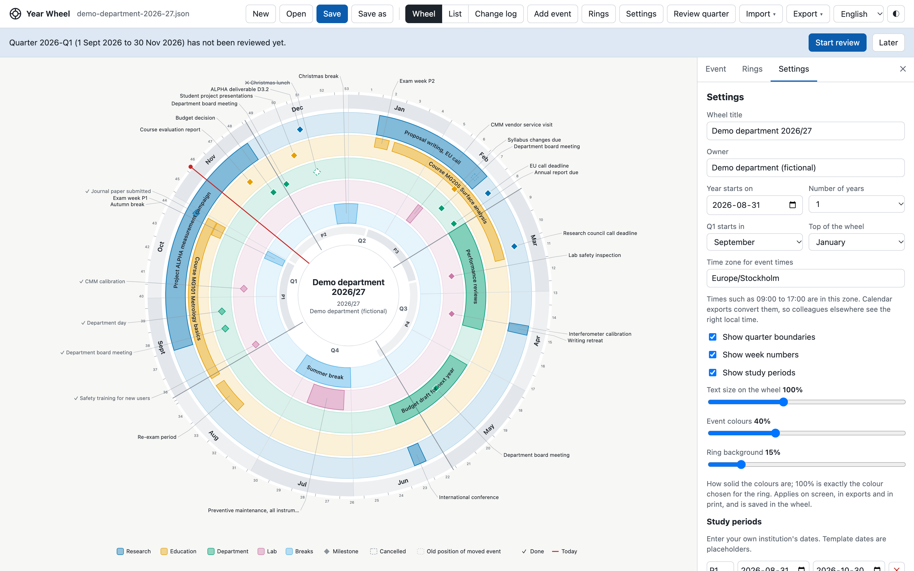

# Year Wheel (årshjul)

**Plan your year on one page.** Year Wheel draws a whole year as a wheel, with one ring for each
area of work (research, education, department, lab, breaks…), so deadlines, courses, meetings and
service visits are visible at a glance. It is a single HTML file that runs in your browser: no
installation, no account, no server, and your data stays in a file on your own computer.

[](https://github.com/rtomkowski/yearwheel/actions/workflows/tests.yml)
[](LICENSE)

**[Try it online](https://rtomkowski.github.io/yearwheel/app/yearwheel.html)** ·
**[Open the demo wheel](https://rtomkowski.github.io/yearwheel/app/demo.html)** ·
**[User guide](https://rtomkowski.github.io/yearwheel/guide.html)** ·
**[Download](https://github.com/rtomkowski/yearwheel/releases/latest)** ·
**[Website](https://rtomkowski.github.io/yearwheel/)**



## Features

- **The whole year in one picture:** months, week numbers, quarters, study periods and today's
  date; January at the top, running clockwise like a clock.
- **Events the way plans really are:** one-day milestones, spans over several days, times (a
  meeting 13:00 to 15:00, a course with the same hours each day, a retreat from lunch to lunch)
  and yearly events.
- **Kept up to date:** a short quarterly review steps through the coming events; every move or
  cancellation keeps its reason in a change log.
- **Rings you control:** up to six, with your own names and colours, shown or hidden as needed.
- **Share it your way:** send the file, print on A4 or A3, export SVG or PNG, export a calendar
  file (.ics) for Outlook and Google Calendar, or a spreadsheet (.csv) for Excel.
- **Import** from Outlook, Google Calendar or a spreadsheet.
- **Templates** for a research team, department administration, lab maintenance and
  calibration, a four-year PhD and course periods.
- **English and Svenska**, light and dark themes, keyboard friendly, colour-blind-safe palette.

| | |
|---|---|
|  |  |
|  |  |

## Get started

1. Download `Year-Wheel.zip` from the [latest release](https://github.com/rtomkowski/yearwheel/releases/latest)
   and unzip it (or just save [`yearwheel.html`](yearwheel.html)).
2. Open `yearwheel.html` in **Chrome or Edge** (Safari and Firefox work too, but save each change
   as a new copy in Downloads).
3. Click **Open** and choose `demo-department-2026-27.json` to look around, or **New** to start
   from a template.
4. Click **Save**. The `.json` file is your wheel; keep it with the app, for example in a shared
   team folder.

The [user guide](https://rtomkowski.github.io/yearwheel/guide.html) explains everything, including
the [spreadsheet format](https://rtomkowski.github.io/yearwheel/guide.html#the-spreadsheet-format) for
importing many events at once.

**Privacy:** the app makes no network requests. The online version only serves the same file;
your wheels are saved on your computer, never on the website.

## For developers

```
yearwheel.html          the whole app: inline CSS, vanilla JavaScript, inline SVG; no build step
schema/                 JSON Schema of a wheel file
templates/              template wheels (English, and Swedish in templates/sv/)
examples/               a fictional demo wheel and a CSV import template
tools/                  Python tools (standard library only, Python 3.8+)
tests/                  pytest suite
docs/                   user guide (Markdown), poster and screenshots
website/                the GitHub Pages site (built by tools/build_site.py)
```

```
python3 tools/validate.py my-wheel.json            # check a wheel file against the schema
python3 tools/ics_to_wheel.py cal.ics --ring Lab   # turn a calendar export into a wheel
python3 -m pip install pytest && python3 -m pytest # run the tests (Node.js enables the JS parser tests)
python3 tools/build_templates.py                   # regenerate templates and embed them in the app
python3 tools/build_release.py                     # screenshots, guide PDF, poster, release ZIP (needs Chrome and pandoc)
python3 tools/build_site.py                        # rebuild website/ (after build_release.py)
```

`CLAUDE.md` describes the conventions (data model, file format, parsers shared between the app and
Python, translations).

## License

Copyright (c) 2026 Robert Tomkowski (rtom@kth.se). Released under the [MIT License](LICENSE): you
may use, copy, change and share Year Wheel freely; it is provided as is, without warranty.

Developed with the assistance of Claude Code (Anthropic).
