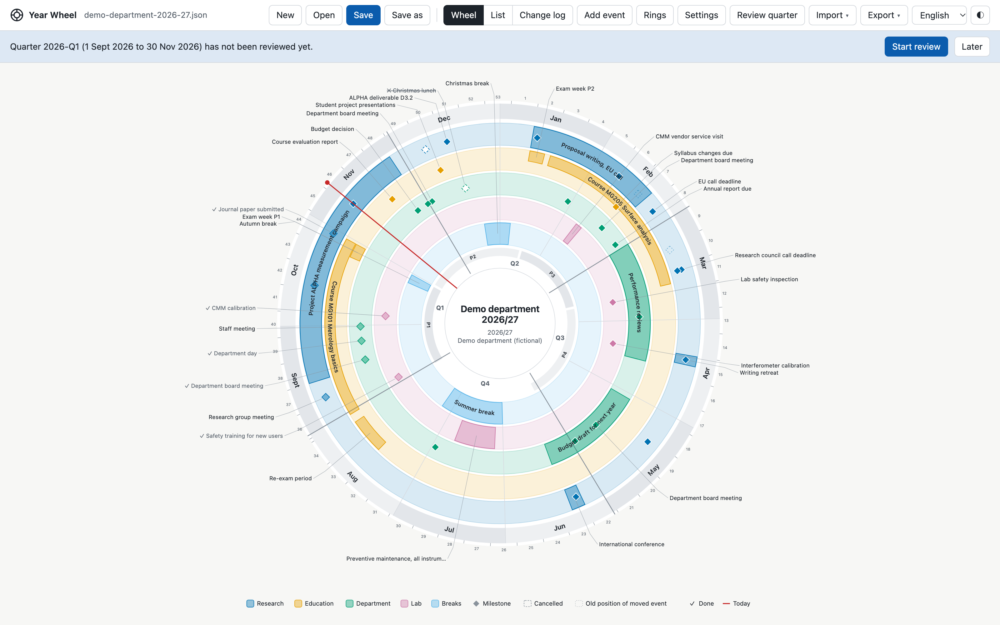
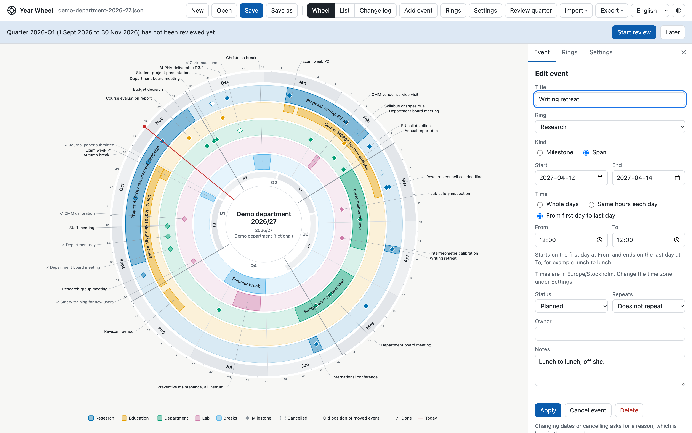
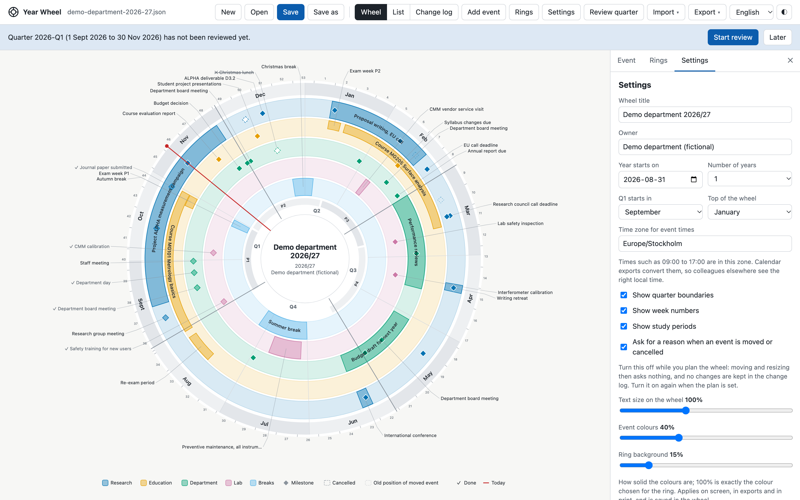
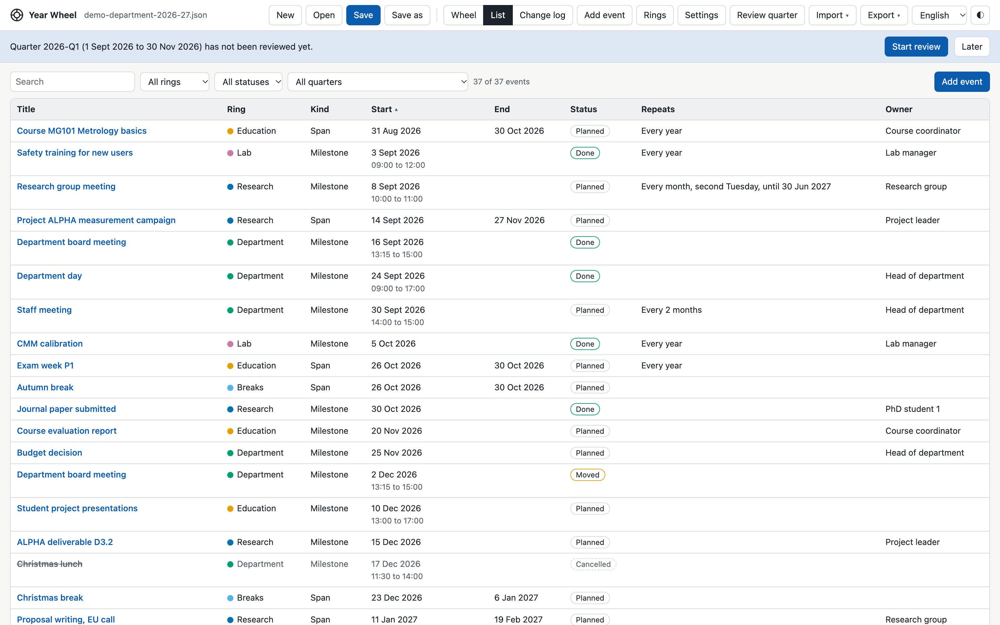
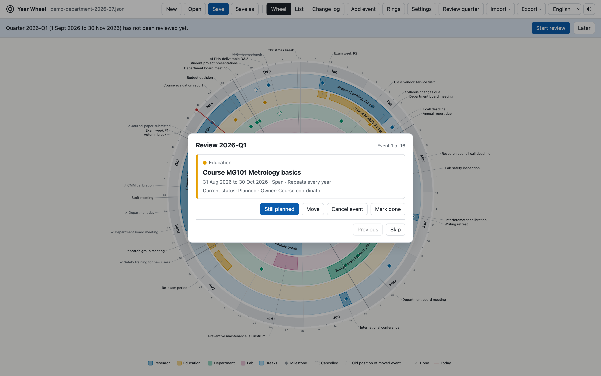

# Year Wheel: user guide

**Plan your year on one page.** Year Wheel draws your year as a wheel, with one ring for each
main area of work: for example Research, Education, Department and Lab. You see the whole year at
a glance, keep it up to date as plans change, and share it as a file, a printout or a calendar.

It is one file, `yearwheel.html`, that you open in your web browser. There is nothing to install,
no account and no server. Your wheel is saved in a file on your own computer, and nothing is sent
over the internet.



## Contents

1. Getting started
2. Reading the wheel
3. Adding and editing events
4. Rings and settings
5. List and change log
6. Reviewing each quarter
7. Saving and sharing
8. Importing and exporting
9. Printing
10. Tips and questions

## 1. Getting started

**What you need:** the file `yearwheel.html` and a web browser. **Google Chrome** or **Microsoft
Edge** work best, because they can save your changes straight back into your file. Safari and
Firefox work too, but save each change as a new copy in your Downloads folder (see section 7).

1. Put `yearwheel.html` somewhere you can find it again, for example in a folder for your team.
2. Open it: double-click it, or right-click it and choose **Open With > Google Chrome**.
3. To look around first, click **Open** and choose `demo-department-2026-27.json`, a demo wheel
   with fictional events.
4. To start your own wheel, click **New** and choose a template:

| Template | Rings | Good for |
|---|---|---|
| Blank | Research, Education, Admin | Starting from scratch |
| Research team | Projects, Funding calls, Conferences and papers, Team | Project milestones and deadlines |
| Department or unit admin | Board and meetings, Budget and finance, Reporting, Staff and HR | The annual admin cycle |
| Lab maintenance and calibration | Calibration, Maintenance, Service visits, Safety | Instruments and service |
| PhD journey (4 years) | Milestones, Courses, Papers and conferences, Teaching | A whole doctorate in one file |
| Course periods | Courses I teach, Courses I take, Exams, Course planning | Teaching across P1 to P4 |

Give the wheel a title and choose the day your year starts: 1 January for a calendar year, or for
example the first day of the autumn term for an academic year. Template events are
**placeholders** marked "(edit me)". Their dates are examples, not your institution's real dates.

5. Click **Save** and choose a name, for example `research-group-2027.json`.

**The .json file is your wheel.** Keep it with `yearwheel.html`, for example in a shared folder.
Next time, open `yearwheel.html` and click **Open** to load it.

The app is available in **English** and **Svenska**. Use the language menu in the toolbar. The
choice is your own and is remembered by your browser; it does not change the wheel file, so
colleagues can use different languages on the same wheel.

## 2. Reading the wheel

- **Months** run clockwise around the edge like a clock, with **January at the top right**. An
  academic year that starts in August simply begins further round, at about 8 o'clock. (To put the
  first month of your year at the top instead, change **Top of the wheel** under Settings.) Small
  numbers outside the months are **week numbers** (can be turned off).
- **Rings** hold your areas of work. The first ring is the outermost. The legend at the bottom
  shows which colour is which ring.
- **Spans** (several days, such as a course or a project phase) are arcs. **Milestones** (one day,
  such as a deadline or a meeting) are diamonds.
- Labels sit on the arc when there is room, otherwise outside the wheel with a thin line to the event.
- **Q1 to Q4** mark the quarters; the thin inner band shows your **study periods** (P1 to P4).
- The **red line** is today.
- Events marked **done** have a tick (✓) and a lighter colour. **Cancelled** events are hollow with a
  struck-through label, so you can still see that something was planned. A **moved** event shows a
  faint outline where it used to be.

Point at any event (or move to it with the Tab key) to see its details: dates, times, status,
owner and notes. Click it to edit it.

## 3. Adding and editing events

Click **Add event**, or click an empty spot on a ring to add an event at that date and ring.
Click an existing event to edit it. The editor opens on the right.



- **Title**, **Ring**, **Owner** and **Notes** are free text.
- **Kind:** a **milestone** is one day; a **span** has a start and an end date.
- **Time:**
  - a milestone is a **whole day** or has a time **from and to**, for example a team day from
    09:00 to 17:00;
  - a span is **whole days**, has the **same hours each day** (for example a course 09:00 to 16:00
    on Monday to Wednesday), or runs **from the first day to the last day** (for example a retreat
    from lunch on Monday to lunch on Wednesday).
- **Status:** planned, moved, done or cancelled.
- **Repeats:** choose **every year** for things that come back, such as an annual report. They
  then appear in every year of the wheel. Choose **weekly** or **monthly** for meetings, such as a
  monthly research group meeting or a department meeting every second month:
  - **Every how many weeks / months:** 1 for every week or month, 2 for every second, and so on.
  - **On** (monthly milestones): the same date each month (for example the 20th), or the same
    weekday of the month (for example the second Tuesday). Months without the date, such as the
    31st, are skipped.
  - **Until** (optional): the last day the meeting can take place. Leave it empty to keep going.

  The line under the fields reads the rule back, for example "Every 2 months, until 30 Jun 2027".
  Each meeting is drawn on the wheel; the label is shown once per series.

Click **Apply** to save the change to the wheel (remember to **Save** the file afterwards).

**Moving and cancelling ask for a reason.** When you change the date or time of an event,
or click **Cancel event**, you are asked why. The reason is kept in the change log, so everyone can
see later what changed and why. **History** at the bottom of the editor shows the changes to that
event. **Delete** removes an event completely (this is also logged).

**Planning without reasons.** While you are still setting up a wheel, the questions get in the way.
In **Settings**, untick **Ask for a reason when an event is moved or cancelled**. Moving, resizing
and cancelling then ask nothing, and no changes are kept in the change log (the change log view
says that it is off). Moved events also keep the status they had, with no faint outline of the old
place. Tick the box again when the plan is set, so later changes are followed up. The setting is
saved in the wheel file, so it applies to everyone who opens it.

**Moving events on the wheel.** You can also drag an event round the wheel to new dates. Drag
the middle of a span, or a milestone, to move it; drag either end of a span to make it longer or
shorter. While you drag, a dashed outline shows the new place and the new dates are shown next to
the pointer. When you let go you are asked for a reason, as in the editor; **Back** (or Escape
while dragging) leaves the event where it was. Dragging moves whole days: times such as 09:00 to
11:00 stay the same on the new day. For a weekly or monthly meeting, dragging moves only that one
meeting; hold **Shift** while dragging to move the whole series. Dragging works with a mouse, a pen
or a finger on a touch screen.

**One meeting of a series.** Click a single meeting on the wheel: the editor shows **This
occurrence** with its date and buttons that change only that meeting: **Move this one** (to the
new date above the buttons), **Cancel this one**, **Mark done**, and **Restore** to put it back as
in the series. Moving and cancelling ask for a reason here too. **Changed occurrences** lists the
meetings that differ from the series; click a date to select it. The other fields in the editor
change the whole series: if you move the series' start, the changed meetings follow along.

Times are in the wheel's **time zone**, shown under the time fields. It is set the first time you
enter a time and can be changed under Settings.

## 4. Rings and settings

Click **Rings** to:

- rename a ring or change its colour;
- move a ring outwards or inwards with the arrows;
- **show or hide** a ring with the box in front of it. A hidden ring is kept, with all its events,
  but is left out of the wheel, prints and images; the other rings get more room. Its events stay
  in the List, change log, reviews and calendar export;
- delete a ring (you choose whether its events move to another ring or are deleted);
- add a ring. Up to 6 rings are allowed; 3 to 4 read best.

Click **Settings** for the wheel as a whole:



- **Wheel title** and **Owner**, shown in the centre of the wheel.
- **Year starts on** and **Number of years.** A wheel can cover several years, for example a PhD.
  Use the year selector in the toolbar to switch between years.
- **Q1 starts in:** the month your first quarter starts.
- **Top of the wheel:** January (the default) or the first month of your year.
- **Time zone for event times.**
- **Show quarter boundaries**, **Show week numbers**, **Show study periods.**
- **Text size on the wheel** (70% to 150%) for all labels, month names, the title and the legend.
- **Event colours** and **Ring background** (how solid the colours are). 100% is exactly the colour
  chosen for the ring. On strong backgrounds, events get a thin outline and labels switch to white
  or black so they stay readable.
- **Study periods:** enter your own dates for P1 to P4 (template dates are only examples).

All of these are saved in the wheel file, so prints and exports look the same for everyone who
opens it. Light or dark colours on screen follow your computer, or the ◐ button in the toolbar.

## 5. List and change log

Switch between **Wheel**, **List** and **Change log** in the toolbar.



- **List** shows every event in a table. Click a column heading to sort. Filter by text, ring,
  status or quarter, for example to see everything in the coming quarter. Click a title to edit.
  This is the quickest way to find things, and works well with the keyboard and screen readers.
- **Change log** shows every change with its date, what changed (before and after) and the
  reason. Below it is the list of quarterly reviews.

## 6. Reviewing each quarter

Plans change, so the wheel works best when you look at it regularly. When a new quarter starts, a
blue banner says that it has not been reviewed yet. Click **Start review** (or **Review quarter**
in the toolbar at any time).



The review goes through each event in the quarter, one at a time:

- **Still planned:** nothing changes.
- **Move:** pick new dates and give a reason.
- **Cancel event:** give a reason.
- **Mark done:** the event is finished.

For weekly and monthly meetings each meeting in the quarter is its own step, and the choices apply
to that meeting only.

At the end, enter your name and an optional note and click **Stamp quarter as reviewed**. The
banner disappears until the next quarter starts. Remember to **Save** afterwards.

Quarters follow the "Q1 starts in" setting and are named after the year in which Q1 starts. With
Q1 in September, September 2026 to August 2027 is 2026-Q1 to 2026-Q4.

## 7. Saving and sharing

- **Save** (Ctrl+S or Cmd+S) writes your changes to the file.
- **Save as** (Ctrl+Shift+S or Cmd+Shift+S) saves a new file under a name you choose. Later saves
  go to the new file.
- The top bar shows **Unsaved changes** until you save, and the browser warns you before closing.
- As a safety net, unsaved changes are also kept in your browser. If you close without saving, you
  are offered to restore them next time. This is only a backup: **the .json file is your wheel.**

**Which browser?**

| | Chrome and Edge | Safari, Firefox and built-in app browsers |
|---|---|---|
| Save | writes over your file (the browser may ask once for permission) | saves a new copy in Downloads under the same name |
| Save as | you choose name and folder | you choose the name; the file goes to Downloads |

**Sharing:** send or share the `.json` file. Anyone with `yearwheel.html` can open it. For a
team, keep both files in a shared folder and agree who updates the wheel, so that two people do
not save over each other's changes.

## 8. Importing and exporting

**Import** (toolbar):

- **Calendar file (.ics)** from Outlook or Google Calendar. In Outlook: File > Save Calendar (or
  drag a calendar to the desktop on a Mac). In Google Calendar: Settings > Import and export >
  Export, then unzip. A dialog lists the events found: choose a ring for each, or one ring for
  all, and untick anything you do not want. Events already in the wheel start unticked, so
  importing the same file twice does not create copies. Meetings keep their times. Weekly and
  monthly series keep their rule, end date and cancelled or moved single meetings (a series on
  several weekdays, such as Monday and Wednesday, keeps only the first day).
- **Spreadsheet (.csv)** from Excel, Numbers, Google Sheets or similar. See "The spreadsheet
  format" below. The import dialog lists any rows it could not read, with their line numbers.

**Export** (toolbar):

- **Calendar file (.ics):** send it to colleagues so they can add all events to Outlook or Google
  Calendar. Whole-day events become all-day entries; timed events become meetings at the right
  local time, even for colleagues in another time zone; spans with the same hours each day become
  a daily meeting; lunch-to-lunch spans become one continuous event. Weekly and monthly meetings
  become one recurring series that stays at the same local time across summer and winter time;
  cancelled and moved single meetings are included.
- **Spreadsheet (.csv):** all events in a table you can open in Excel, edit, and import again.
  It uses exactly the format below, so a wheel can go out to a spreadsheet and back.
- **SVG image:** a sharp picture for documents and slides.
- **PNG image:** a high-resolution picture.

Exports and prints always use light colours, even if you use the dark theme on screen.

### The spreadsheet format

The easiest start is **Import > Spreadsheet template (.csv)**: it downloads a small example file
with one row of each kind. Open it in Excel, replace the rows with your own, save it as CSV, and
import it. A copy, `year-wheel-import-template.csv`, is also in the package.

The first row names the columns. Only **title** and **start** are required; the columns can be in
any order, and empty cells are fine.

| Column | What to write | Example |
|---|---|---|
| title | the name of the event (required) | Board meeting |
| start | first day, written YYYY-MM-DD (required) | 2027-04-12 |
| end | last day, for an event over several days; leave empty for one day | 2027-04-14 |
| ring | the name of a ring in your wheel; unknown names go to the ring you pick when importing | Department |
| status | planned, moved, done or cancelled (empty means planned) | planned |
| start time | HH:MM, for an event with a time | 13:00 |
| end time | HH:MM | 15:00 |
| timing | only for several days with times: `daily` (same hours each day) or `continuous` (from the first day to the last, for example lunch to lunch) | daily |
| repeats | `yearly`, `weekly`, `monthly`, `every 2 weeks`, `every 3 months`; add `by weekday` to a monthly value for the same weekday of the month (the 2nd Tuesday); empty means once | every 2 months |
| until | last day of a weekly or monthly repeat, YYYY-MM-DD; empty means no end | 2027-06-30 |
| owner | who is responsible | Head of department |
| notes | any text | Room M2 |

Examples of complete rows:

```
title;start;end;ring;status;start time;end time;timing;repeats;until;owner;notes
Budget draft;2027-02-01;2027-03-15;Department;planned;;;;;;Head of department;
Board meeting;2027-04-12;;Department;planned;13:00;15:00;;;;;
Course week;2027-03-02;2027-03-04;Education;planned;09:00;16:00;daily;;;;
Writing retreat;2027-05-10;2027-05-12;Research;planned;12:00;12:00;continuous;;;;Lunch to lunch
Annual report due;2027-02-26;;Department;planned;;;;yearly;;;
Research group meeting;2027-01-12;;Research;planned;10:00;11:00;;monthly by weekday;2027-06-30;;
Department meeting;2027-01-20;;Department;planned;14:00;15:30;;every 2 months;;;
```

Good to know:

- Commas, semicolons and tabs between columns all work. Files from the app use semicolons and
  start with a `sep=;` line, which tells Excel how to split the columns; you can leave it in.
- Text that itself contains a semicolon, comma, quote or line break must be in double quotes,
  which Excel does automatically.
- Swedish column names (titel, slut, starttid, sluttid, upprepas, till och med, ansvarig,
  anteckningar), status words (planerad, flyttad, klar, inställd) and repeat words (varje vecka,
  varannan månad, var 3:e månad, på veckodag) are accepted too.
- Single changed meetings of a series are not part of the spreadsheet; use the calendar file
  (.ics) or the wheel file to keep them.
- Importing the same file again does not create copies: rows with the same title and start date as
  an existing event start unticked.

## 9. Printing

Use **Export > Print A4 landscape** or **Print A3 landscape**. The print dialog opens with the wheel
sized to the page, with the title, year and print date at the bottom. **A3 is best for busy
wheels.** To make a PDF, choose "Save as PDF" in the print dialog. To leave a ring out of the print,
hide it under Rings first.

## 10. Tips and questions

**Keyboard.** Tab moves between events on the wheel; Enter opens one. N adds an event. Escape
closes the open dialog, menu or editor. Ctrl/Cmd+S saves, Ctrl/Cmd+Shift+S saves as, Ctrl/Cmd+O
opens.

**The labels are crowded.** Hide a ring you do not need right now, lower the text size, use A3 for
printing, or use the List view for details.

**I need bigger buttons and menus.** Use your browser's zoom: Ctrl or Cmd with + and -.

**Where is my data?** Only in your `.json` file (and, as a backup of unsaved changes, in your own
browser). Nothing is uploaded anywhere.

**Can two people edit at the same time?** Not safely: the last one to save wins. Agree who updates
the shared file, or keep one wheel per person and share exports.

**Is my institution's calendar built in?** No. Templates contain example dates only. Enter your
own study periods under Settings and your own dates for each event.

**The file opened with a warning.** The app checks files when it opens them and lists anything
that looks wrong, for example an event without a valid date. Fix those events and save.

## License

Copyright (c) 2026 Robert Tomkowski (rtom@kth.se). Released under the MIT License: you may use, copy, change and share Year Wheel freely; it is provided as is, without warranty. See the `LICENSE` file for the full text.

Developed with the assistance of Claude Code (Anthropic).
